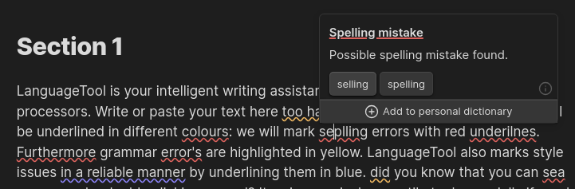

# Language Tool

Spelling and grammar checking in [Obsidian](https://obsidian.md) with [LanguageTool](https://languagetool.org/), on your own LanguageTool server or on LanguageTool's public and Premium servers.



Language Tool is a fork of [obsidian-languagetool](https://github.com/wrenger/obsidian-languagetool) by Lars Wrenger, which is a fork of [obsidian-languagetool-plugin](https://github.com/Clemens-E/obsidian-languagetool-plugin) by Clemens Ertle. See [Credits and licence](#credits-and-licence).

## Changes from the original

- **Preferred languages.** Auto detection can be told which languages you write in, so a short paragraph with a typo is no longer checked as German, Slovenian or Esperanto.
- **A language for each paragraph.** With your own server, every paragraph can be checked in its own language, so a note can mix English and Spanish, for example.
- **Text in other languages** can be left unchecked, so a quotation in French gets no French suggestions.
- **Click an underline to see its suggestions.** Hovering opens them too, without the misses after scrolling that CodeMirror's hover tooltips had. Escape closes them.
- **Automatic checking checks a note when you open it**, not only the paragraphs you edit.
- **Suggestions keep the formatting.** A suggestion changes only the characters that differ, so emphasis markers, links, footnotes and comments next to a mistake stay intact, and a space forgotten next to a marker goes on its outer side: «y\*\*aseguró\*\*» becomes «y \*\*aseguró\*\*». Before a suggestion next to markup is offered, it is tried on its paragraph and the markdown is read again; if any formatting would change, the suggestion is shown but cannot be applied.
- **Spanish typography (RAE).** Spanish text is also checked against rules of the RAE's *Libro de estilo* that LanguageTool lacks, such as the full stop after closing quotation marks, em dashes, thousands, dates and «angular» quotation marks.
- **British spelling.** "-ise" and "-ize" are both accepted in British English, unless you ask for Oxford spelling.
- **Spanish varieties.** Spanish can be checked as generic Spanish, Spanish from Spain, or Spanish with voseo («vos tenés»), which generic Spanish marks as an error.
- **Obsidian syntax is not checked:** comments, tags, callout markers, block IDs, embeds and highlight markers. Inline code and maths read as a neutral word, so they no longer cause spacing warnings.
- A note language given without a variety (`lt-language: en`) is checked in the variety chosen in the settings. Before, it silently turned off spell checking.
- Long notes are checked in parts, so they no longer fail on the public server's limit of 20,000 characters per request.
- A malformed link containing an email address no longer stops the whole note from being checked.
- Auto-check keeps a separate state for every open note. Before, editing two notes in quick succession could leave the first unchecked and check the second at the wrong positions.
- Text edited while a check is running is checked again once the check has finished.
- Choosing a suggestion from the right-click menu replaces the right word.
- "Accept all suggestions" skips suggestions that overlap another one, instead of garbling the text.
- "Add to dictionary" works for every kind of spelling match and always syncs with LanguageTool Premium, from the tooltip, the menu and the command.
- A note's `lt-dictionary` adds to your ignored words instead of replacing them.
- Changing the server loads the language list from the new server, once you have stopped typing.
- Loading the language list and syncing the dictionary no longer delay starting Obsidian.
- The synonyms setting says that synonyms are looked up on LanguageTool's servers, even when you use your own.

## Installation

Language Tool is not in the community plugin list. To install it, build it from source:

1. Install [Bun](https://bun.sh), then run `bun install` and `bun run build` in this repository.
2. Copy `main.js`, `styles.css` and `manifest.json` into `VaultFolder/.obsidian/plugins/language-tool/`.
3. In Obsidian, enable Language Tool under Settings → Community plugins.

## Usage

Hotkeys for the commands can be set under Settings → Hotkeys; search for "Language Tool". Make sure they do not clash with existing hotkeys. You may want to turn off Obsidian's own spellcheck (Settings → Editor → Spellcheck): its underlines look similar but come from your system's dictionary, and show no suggestions when you click or hover.

- **Check text** checks the whole note, or only the selected text. Click an underlined word, or rest the mouse on it, to see its suggestions, with the option to add the word to your dictionary or to disable the rule.
- **Clear suggestions** removes all underlines.
- **Toggle automatic checking** turns checking as you type on or off. With it on, a note is also checked when you open it, unless you turn off "Check notes when opened".
- **Accept all suggestions** applies the first suggestion of every underline.

In Live Preview, callouts and tables are drawn as rendered blocks, which show no underlines. Click into one to edit it, and its underlines appear.

LanguageTool detects the language of the text it checks unless you choose a static language under Settings → Language Tool → Static language. It detects one language for each request: "Check text" sends the whole note, and automatic checking sends the paragraphs you have just edited.

### Preferred languages

Detection only sees the text being checked, so a short paragraph with a typo is sometimes detected as an unrelated language ("Teh hous" as Slovenian, for example). Under Settings → Language Tool → Preferred languages, add the languages you write in, and detection will favour them. Text that is clearly in another language is still detected as such.

"Text in other languages" decides what happens to a paragraph detected as a language that is not preferred, such as a quotation:

- **Check it in its own language** (the default) gives suggestions in that language.
- **Leave it unchecked** skips it, so you only ever get suggestions in your own languages. A paragraph of yours that is misdetected is skipped too.
- **Check it as one of these languages** checks everything as one of the preferred languages. It also corrects misdetected paragraphs, but marks quotations in other languages as errors.

### A language for each paragraph

As a note is checked in one language, a note that mixes languages has the paragraphs in the other language marked as errors. "Detect the language of each paragraph" checks every paragraph, heading and list item in a separate request, so each gets its own language. A phrase in another language inside a paragraph is still checked in the paragraph's language. Short paragraphs are easily misdetected, so use it together with preferred languages.

It sends one request per paragraph, which the public and Premium servers would refuse, so it is only available with your own server.

### Spanish typography (RAE)

LanguageTool checks Spanish spelling and grammar well, but misses much of the orthotypography of the RAE's *Libro de estilo de la lengua española*. Under Settings → Language Tool → Spanish typography (RAE), the plugin adds these checks to every paragraph LanguageTool detects as Spanish:

| Rule | Wrong | Right |
|---|---|---|
| Full stop after closing signs | «No te vayas.» | «No te vayas». |
| No full stop after ? or ! | ¿Vienes?. | ¿Vienes? |
| Colon after a letter greeting | Estimados vecinos, | Estimados vecinos: |
| Em dashes joined to the aside | la subasta — la mayor del año — cerró | la subasta —la mayor del año— cerró |
| Hyphen in ranges | 1998–2012 | 1998-2012 |
| Thousands with a space | 1.250.000 · 1,250,000 | 1 250 000 |
| Space before % | 40% | 40 % |
| Dates in Spanish order | Octubre 30, 2020 | 30 de octubre de 2020 |
| Months and days in lower case | el Lunes 3 de Enero | el lunes 3 de enero |
| Positions in lower case | el Rey Felipe, el Papa Francisco | el rey Felipe, el papa Francisco |
| Headings in sentence case | Historia Y Desarrollo De La Ciudad | Historia y desarrollo de la ciudad |
| «Angular» quotation marks first | “cita” · "cita" | «cita» |
| Quotation marks or italics, not both | “*At Day's Close*” | *At Day's Close* (a complete work) · «At Day's Close» (a quotation or part of a work) |

The rules leave alone what the norm accepts, as well as proper names ("Julio César", "Plaza de Mayo", "Movimiento 2 de Junio"), abbreviations ("etc.)") and dialogue ("—Bien —contestó Juan—"). Any of them can be turned off with "Disable rule". For headings, every word after the first is lowered except proper names: words LanguageTool's dictionary only knows with a capital («Cartagena»), words the note writes with a capital in the middle of a sentence («la vida de Pedro de Heredia»), and acronyms («ONU»). For quotation marks around italics, both fixes are offered, as the plugin cannot tell a title from a quotation.

### Language varieties

Under Settings → Language Tool → Language varieties, choose how English, German, Portuguese, Catalan and Spanish are checked when detected, and when a note's `lt-language` gives only the language (`lt-language: es`). For Spanish:

- **Spanish (generic)**, the default, marks voseo as an error: «vos tenés» → «tú tienes».
- **Spanish (Spain)** does the same, with peninsular conventions.
- **Spanish (voseo)** accepts «vos sabés», «tenés», «querés», as in Río de la Plata and Central American Spanish.

LanguageTool has no other regional Spanish, so vocabulary of a particular country is not checked differently.

### British spelling

LanguageTool's British English marks "realise" and "organise" and suggests "realize" and "organize". Both spellings are correct British English; the "-ize" one is the house style of Oxford University Press. The plugin leaves both alone unless you turn on "Oxford spelling in British English".

### Ignored words

Words can be added to the dictionary from the editor and removed again under Settings → Language Tool → Spellcheck dictionary.

## Note-specific settings

These properties override the settings for one note:

```md
---
lt-language: en-US     # text: language code or "auto"
lt-preferredLanguages: # multitext: languages favoured by "auto", replacing the global ones
  - en
  - es
lt-picky: true         # boolean: more style suggestions
lt-autoCheck: true     # boolean: check as you type
lt-dictionary:         # multitext: ignored words, added to the global ones
  - foo
  - bar
lt-disabledRules:      # multitext: ignored rules, added to the global ones
  - ARROWS
lt-disabledCategories: # multitext: ignored categories, added to the global ones
  - STYLE
---

# Some note...
```

## Privacy

With the public or Premium server, the text you check is sent to LanguageTool. To keep your notes on your computer, run [your own LanguageTool server](https://dev.languagetool.org/http-server), choose the custom endpoint and set its URL, for example `http://localhost:8081`.

"Find synonyms" always uses LanguageTool's servers, whichever server you check with, and sends the sentence around the selected word.

## Premium accounts

Language Tool supports LanguageTool Premium. You need a Premium account and an API key, which you can create at <https://languagetool.org/editor/settings/access-tokens>. Choose the premium endpoint and enter your email address and API key in the settings.

Please report problems with Language Tool in this repository, not to LanguageTool or to the original plugin's authors.

## Development

- `bun run build` runs Obsidian's official ESLint plugin ([eslint-plugin-obsidianmd](https://github.com/obsidianmd/eslint-plugin)) on every source file, the scripts, the tests and `package.json`, and stops at the first warning. It then type-checks and builds `main.js`.
- `bun run lint` runs the linter on its own.
- `bun test` runs the tests. The tests in `src/test/server.test.ts` need a LanguageTool server at `http://localhost:8081`, or the one given in `LT_SERVER`, and are skipped when none is reachable.

## Credits and licence

Language Tool is based on the work of Lars Wrenger ([obsidian-languagetool](https://github.com/wrenger/obsidian-languagetool)), Clemens Ertle ([obsidian-languagetool-plugin](https://github.com/Clemens-E/obsidian-languagetool-plugin)), Matthew Meyers and the other contributors to those projects, whose commits are kept in this repository's history.

Like the original, it is free software under the [GNU Affero General Public License version 3](LICENSE.md), or any later version.
