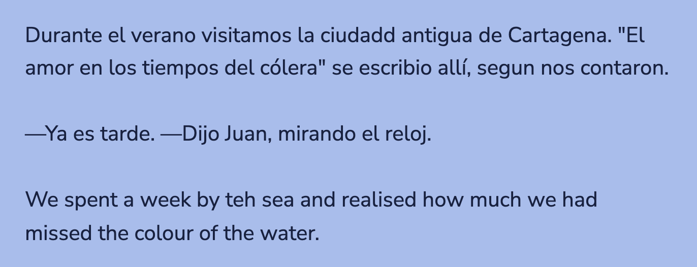
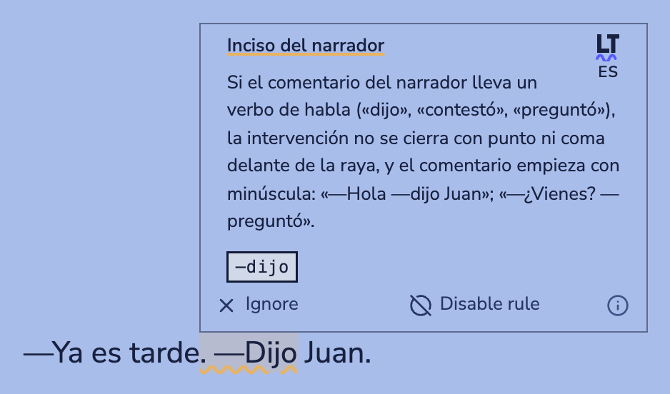
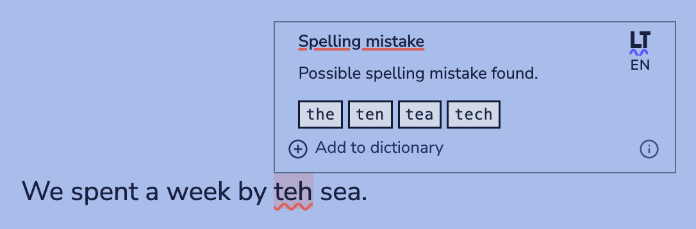
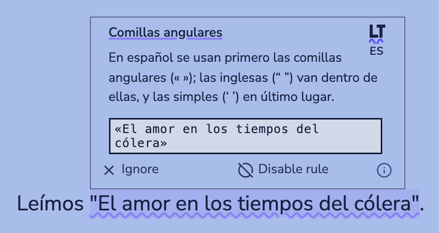

<h1 align="center">Language Tool Advanced</h1>

<p align="center">Spelling, grammar and Spanish style checking for <a href="https://obsidian.md">Obsidian</a>, with <a href="https://languagetool.org">LanguageTool</a>.</p>

<p align="center">
  <a href="https://github.com/DuckTapeKiller/language-tool-advanced/releases/latest"></a>
  
  <a href="LICENSE.md"></a>
</p>

<p align="center">
  <picture>
    <source media="(prefers-color-scheme: dark)" srcset="docs/images/note-dark.png">
    
  </picture>
</p>

Language Tool Advanced underlines spelling, grammar and style mistakes as you write in Obsidian, and fixes them with a click. It checks with LanguageTool, on your own server or on LanguageTool's, and adds what LanguageTool alone does not do well: notes that mix languages, the Spanish of the Real Academia Española, and Markdown that has been through a copy and paste.

## Highlights

- **A language for every paragraph.** A note can mix English and Spanish, and each paragraph is checked in its own language. A short paragraph with a typo is no longer taken for Slovenian or Esperanto.
- **The RAE's rules for Spanish.** Dialogue punctuation, «angular» quotation marks, the opening «¿» and «¡», abbreviations, Latin in italics, numbers and dates, and common mistakes such as «Si tendría» or «La dije que», from the *Libro de estilo de la lengua española* and the *Diccionario panhispánico de dudas*.
- **Fixes that keep your formatting.** Bold, italics, links, footnotes and comments around a mistake stay where they are. A fix that would break them is shown, but cannot be applied.
- **Made for messy Markdown.** Words split across runs of bold, quotation marks inside bold, character references, soft hyphens and words glued to markup are all checked and fixed properly.
- **Checked as you open and as you type.** A note is checked as soon as it is shown in editing view, and every paragraph you edit is checked again a moment after you stop typing.
- **Private if you want it.** With your own LanguageTool server, your notes never leave your computer.

## Contents

- [Installation](#installation)
- [Choosing a server](#choosing-a-server)
- [Using it](#using-it)
- [Languages](#languages)
- [Spanish and the RAE](#spanish-and-the-rae)
- [Markdown and Obsidian syntax](#markdown-and-obsidian-syntax)
- [Settings for one note](#settings-for-one-note)
- [Settings](#settings)
- [Privacy](#privacy)
- [Troubleshooting](#troubleshooting)
- [Development](#development)
- [Credits and licence](#credits-and-licence)

## Installation

Language Tool Advanced is not in Obsidian's community plugin list yet. Install it in one of these ways.

### From a release

1. Download `main.js`, `manifest.json` and `styles.css` from the [latest release](https://github.com/DuckTapeKiller/language-tool-advanced/releases/latest).
2. Put them in a folder called `language-tool` inside your vault's `.obsidian/plugins/` folder.
3. In Obsidian, open Settings → Community plugins, reload the list and turn on Language Tool Advanced.

### With BRAT

With the [BRAT](https://github.com/TfTHacker/obsidian42-brat) plugin installed, choose "Add a beta plugin for testing" and enter `DuckTapeKiller/language-tool-advanced`. BRAT installs it and keeps it up to date.

### From source

Install [Bun](https://bun.sh), then run `bun install` and `bun run build` in a clone of this repository, and copy `main.js`, `manifest.json` and `styles.css` into the folder described above.

## Choosing a server

Every check goes to a LanguageTool server. Choose one under Settings → Language Tool Advanced → Endpoint.

| | Your own server | LanguageTool public | LanguageTool Premium |
|---|---|---|---|
| Your notes stay on your computer | Yes | No | No |
| Cost | Free | Free | Paid |
| Limits | None | 20 requests a minute, 20,000 characters each | 80 requests a minute, 75,000 characters each |
| A language for each paragraph | Yes | No | No |
| Premium rules and suggestions | No | No | Yes |

Long notes are split into parts that fit the server's limit, so they are checked in full on every server.

### Running your own server

The quickest way is [Docker](https://www.docker.com):

```bash
docker run -d --name languagetool -p 8010:8010 erikvl87/languagetool
```

Then choose the `(custom)` endpoint and set the server URL to `http://localhost:8010`. Without Docker, download LanguageTool from [languagetool.org](https://languagetool.org/download/) and start its [HTTP server](https://dev.languagetool.org/http-server) with Java; its default port is 8081.

### Premium accounts

You need a LanguageTool Premium account and an API key, which you can create on [LanguageTool's access tokens page](https://languagetool.org/editor/settings/access-tokens). Choose the `(premium)` endpoint, then enter your email address as the API username and the key as the API key. The key is kept in Obsidian's secret storage.

## Using it

### Underlines and suggestions

Mistakes are underlined in three colours: red for spelling, yellow for grammar and punctuation, and purple for style. Click an underline, or rest the mouse on it, to open its suggestions.

<p align="center">
  <picture>
    <source media="(prefers-color-scheme: dark)" srcset="docs/images/box-dialogue-dark.png">
    
  </picture>
  &nbsp;
  <picture>
    <source media="(prefers-color-scheme: dark)" srcset="docs/images/box-english-dark.png">
    
  </picture>
</p>

The box shows:

- **The mistake and the rule**, underlined in its colour, with an explanation.
- **The fixes.** Click one to apply it. A greyed-out fix would change the formatting around it, and has to be made by hand.
- **The language** the paragraph was checked in, under the LanguageTool mark in the corner: ES, EN and so on. Rest the mouse on it to see the language in full, such as "British English".
- **Ignore**, which hides this underline, and **Disable rule**, which turns the rule off everywhere.
- **Add to dictionary**, for words that are not mistakes.
- **Change all**, for a misspelling found more than once in the note, which corrects every occurrence at once.
- **Fix all**, for the plugin's Spanish rules, which applies the same fix everywhere in the note, for example every quotation to «».
- **The info button**, which shows the rule's name and category.

A single undo reverts any of these. Escape closes the box, and clicking the underline again opens it.

### Commands

Search for "Language Tool Advanced" in the command palette, or give the commands hotkeys under Settings → Hotkeys.

| Command | What it does |
|---|---|
| Check text | Checks the whole note, or only the selected text. |
| Clear suggestions | Removes every underline from the note. |
| Toggle automatic checking | Turns checking as you type on or off. |
| Accept all suggestions | Applies the first fix of every underline, skipping any that overlap. |
| Jump to next suggestion | Selects the next underline after the cursor. |
| Accept suggestion 1 to 8 | Applies that fix of the underline at the cursor. |
| Add to dictionary | Adds the misspelled word at the cursor to your dictionary. |
| Show synonyms | Shows synonyms for the selected word, in English or German. |

The right-click menu also offers the fixes of the underline you clicked.

### Automatic checking

With "Auto check text" on, a paragraph is checked again a moment after you stop typing in it. With "Check notes when opened" on as well, a whole note is checked the first time it is shown in editing view: when you open it, switch to its tab, or switch it from reading view to editing view. Underlines appear as each part of the note comes back from the server, and you can keep typing while a long note is being checked.

## Languages

LanguageTool detects the language of the text it checks, unless you choose a static language. These settings decide how well that works for you.

### Preferred languages

Detection only sees the text being checked, so a short paragraph with a typo can be detected as an unrelated language: "Teh hous" as Slovenian, for example. Add the languages you write in under Preferred languages, and detection will favour them. Text that is clearly in another language is still detected as such.

### Text in other languages

This decides what happens to a paragraph detected as a language you do not write in, such as a quotation:

- **Check it in its own language** gives suggestions in that language.
- **Leave it unchecked** skips it, so you only ever get suggestions in your own languages.
- **Check it as one of these languages** checks everything as one of your languages. It also corrects misdetected paragraphs, but marks quotations in other languages as mistakes.

### A language for each paragraph

A note is otherwise checked in a single language, so in a note that mixes languages the paragraphs in the other one are full of underlines. "Detect the language of each paragraph" sends every paragraph, heading, list item and table row in a request of its own, so each gets its own language. A phrase in another language inside a paragraph is still checked in the paragraph's language. As this sends many requests, it is only available with your own server.

### Language varieties

Choose how English, German, Portuguese, Catalan and Spanish are checked when they are detected, or when a note's `lt-language` gives only the language. For Spanish:

- **Spanish (generic)**, the default, marks voseo as a mistake: «vos tenés» → «tú tienes».
- **Spanish (Spain)** does the same, with peninsular conventions.
- **Spanish (voseo)** accepts «vos sabés», «tenés» and «querés», as in Río de la Plata and Central American Spanish.

### British spelling

LanguageTool's British English marks "realise" and "organise" and suggests "realize" and "organize". Both are correct British English; the "-ize" spelling is the house style of Oxford University Press. Both are accepted unless you turn on "Oxford spelling in British English".

## Spanish and the RAE

LanguageTool checks Spanish spelling and grammar well, but misses much of the orthotypography of the RAE's *Libro de estilo de la lengua española*, and several constructions the *Diccionario panhispánico de dudas* corrects. With "Spanish typography (RAE)" on, every paragraph detected as Spanish is also checked against these rules.

<p align="center">
  <picture>
    <source media="(prefers-color-scheme: dark)" srcset="docs/images/box-quotes-dark.png">
    
  </picture>
</p>

| Rule | Wrong | Right |
|---|---|---|
| Full stop after closing signs | «No te vayas.» | «No te vayas». |
| No full stop after ? or ! | ¿Vienes?. | ¿Vienes? |
| Opening ¿ and ¡ | Qué hora es? · Juan, vienes? | ¿Qué hora es? · Juan, ¿vienes? |
| Question marks not doubled | ¿¿Qué?? | ¿Qué? |
| Colon after a letter greeting | Estimados vecinos, | Estimados vecinos: |
| Dialogue with rayas joined to the words | — Hola —dijo Juan. · – Hola –dijo Juan–. ¿Tú? | —Hola —dijo Juan. · —Hola —dijo Juan—. ¿Tú? |
| No full stop or comma before a verb of saying, which is in lower case | —Hola. —Dijo Juan. · —Hola, —dijo Juan—, ¿qué tal? | —Hola —dijo Juan. · —Hola —dijo Juan—, ¿qué tal? |
| Asides between rayas, joined to them | la subasta — la mayor del año — cerró · la subasta - la mayor del año - cerró | la subasta —la mayor del año— cerró |
| Closing raya at the end of a sentence | Se llama José Luis —al menos que yo sepa. | Se llama José Luis —al menos que yo sepa—. |
| Hyphen in ranges | 1998–2012 | 1998-2012 |
| Thousands with a space, none in four digits | 20.000 · 1.250.000 · 1,250,000 · 1.250 | 20 000 · 1 250 000 · 1250 |
| Space before % | 40% | 40 % |
| Dates in Spanish order | Octubre 30, 2020 | 30 de octubre de 2020 |
| Months and days in lower case | el Lunes 3 de Enero | el lunes 3 de enero |
| Positions in lower case | el Rey Felipe, el Papa Francisco | el rey Felipe, el papa Francisco |
| Headings in sentence case | Historia Y Desarrollo De La Ciudad | Historia y desarrollo de la ciudad |
| No full stop after a heading | ## La historia de la ciudad. | ## La historia de la ciudad |
| A space after each full stop of an abbreviation | EE.UU. · EEUU · 384 a.C. · 10am · S.A. · J.L. González | EE. UU. · 384 a. C. · 10 a. m. · S. A. · J. L. González |
| «Angular» quotation marks first, joined to the words | “cita” · "cita" · " cita " · “cita" | «cita» |
| Quotation marks or italics, not both | “*At Day's Close*” | *At Day's Close* (a complete work) · «At Day's Close» (a quotation or part of a work) |
| Latin and foreign expressions in italics, Latin without accents | in situ · status quo · de motu propio · sui géneris · deja vu | *in situ* · *statu quo* · *motu proprio* · *sui generis* · *déjà vu* |
| Phrases | abordo del barco · en aras a · volví en sí · el onceavo aniversario · no siendo que · en frente de | a bordo del barco · en aras de · volví en mí · el undécimo aniversario · no sea que · enfrente de |
| Grammar | Si tendría dinero · La dije que viniera · Nadie no vino · Se buscan a los culpables · Es importante de que · Me olvidé que · No cabe duda que · ¡Sentaros! · Váyasen · para tú | Si tuviera dinero · Le dije que viniera · Nadie vino · Se busca a los culpables · Es importante que · Me olvidé de que · No cabe duda de que · ¡Sentaos! · Váyanse · para ti |
| Style | Por último, agradecer a todos… · los y las alumnas | Por último, quiero agradecer a todos… · los alumnos, or los alumnos y las alumnas |

### What is left alone

The rules leave alone what the norm accepts, and much that only looks like a mistake:

- Proper names («Julio César», «Plaza de Mayo», «Movimiento 2 de Junio»), abbreviations («etc.», «Ing.», «JJ. OO.») and identifiers («NIT 890.902.922-6»).
- Dialogue written correctly, also when a whole conversation is quoted on one line, and lists that start with a dash.
- Quotations in other languages, English text inside a Spanish note, and titles that end in «?» or «!» («se publicó como Fake! (1969)»).
- Quotation marks nested inside angular ones («Me dijo: “Vaya ‘cacharro’”»), as the norm prescribes.
- Wrong forms that a text cites as such, as notes on grammar do: «no ®váyasen», «no X el onceavo piso», «(no Se buscan a los culpables)».
- Web addresses, volume numbers, uncertain dates («1875?») and affixes («-r», «r-»).

Headings are put in sentence case, but proper names keep their capital: words LanguageTool only knows with a capital («Cartagena»), words it does not know at all («Ayiti»), words the note writes with a capital in the middle of a sentence, acronyms, and the first word of a second sentence. Where LanguageTool already reports the same mistake with the same fix, only one underline is shown. Any rule can be turned off with "Disable rule".

## Markdown and Obsidian syntax

Only the prose of a note is checked. Left out are code and code blocks, maths, comments (`%%…%%`), tags, callout markers, block IDs, embeds, HTML tags, frontmatter, footnote markers and the addresses of links. Inline code, maths and a tag in the middle of a sentence read as a neutral word, so the sentence around them is still checked as one. Each table cell is read as a paragraph of its own, and the letter of a lettered list («b.») is not taken for a misspelling.

Fixes are made with care for the formatting around them:

- A fix changes only the characters that differ, so markers, links, footnotes and comments next to a mistake stay in place.
- A space forgotten next to a marker goes outside it: «y\*\*aseguró\*\*» becomes «y \*\*aseguró\*\*».
- A word split across two runs of bold is joined in one: «\*\*desarroll\*\* \*\*aron\*\*» becomes «\*\*desarrollaron\*\*».
- Quotation marks split into runs of bold become angular in one run: «\*\*"\*\* \*\*El Descubrimiento de Europa\*\* \*\*"\*\*» becomes «\*\*«El Descubrimiento de Europa»\*\*».
- A misspelling glued to markup, as in «la\*\*ciudadd\*\*», first gets its missing space, then its correction.
- A quotation mark or bracket that is never closed is closed at the end of its line, before a final full stop in Spanish.
- Character references (`&nbsp;`, `&amp;`), `<br>` and soft hyphens read as what they stand for, and brackets that restore letters inside a word read as the whole word: «her[i]do» is checked as «herido».

Before a fix next to markup is offered, it is tried on its paragraph and the Markdown is read again. If it would turn a line into a list or a heading, empty a run of italics, or change the formatting in any other way, the fix is shown greyed out instead.

## Settings for one note

These properties override the settings for a single note:

```yaml
---
lt-language: en-US         # a language code, or "auto"
lt-preferredLanguages:     # the languages favoured by "auto", instead of the global ones
  - en
  - es
lt-picky: true             # more style suggestions
lt-autoCheck: false        # do not check as you type
lt-dictionary:             # words to ignore, added to the global ones
  - Macondo
lt-disabledRules:          # rules to ignore, added to the global ones
  - RAE_COMILLAS_ANGULARES
lt-disabledCategories:     # categories to ignore, added to the global ones
  - STYLE
---
```

With "Inject property types" on, Obsidian knows the type of each of these properties, so the properties editor shows a toggle or a list for them.

## Settings

| Setting | What it does |
|---|---|
| Endpoint | The server to check with: LanguageTool's public or Premium server, or your own. |
| Server URL | The address of your own server, such as `http://localhost:8010`. |
| API username, API key | Your Premium account. |
| Auto check text | Checks the paragraphs you edit as you type. |
| Check notes when opened | With automatic checking on, checks the whole note when it is first shown in editing view. |
| Auto check delay | How long to wait after you stop typing before checking. |
| Find synonyms | Turns on synonyms for English or German, which always come from LanguageTool's servers. |
| Static language | Checks every note in one language instead of detecting it. |
| Preferred languages | The languages you write in, and what to do with text in others. |
| Detect the language of each paragraph | Checks every paragraph in its own language. Your own server only. |
| Spanish typography (RAE) | The plugin's rules for Spanish. |
| Oxford spelling in British English | Marks "-ise" spellings in British English. |
| Language varieties | The variety of English, German, Portuguese, Catalan and Spanish to check in. |
| Mother tongue | Warns about false friends in other languages, and helps detection. |
| Spellcheck dictionary | Your ignored words, which can be synced with LanguageTool Premium. |
| Picky mode | Turns on LanguageTool's stricter style rules. |
| Categories and rules | Turns categories and rules on or off. |
| Long check notification | Shows a notice while a long manual check runs. |
| Inject property types | Registers the types of the `lt-` properties. |
| Copy error logs to clipboard | Copies recent errors, without your API key, for a bug report. |

## Privacy

With LanguageTool's public or Premium server, the text you check is sent to LanguageTool. With your own server, nothing leaves your computer. Synonyms are the one exception: "Show synonyms" always asks LanguageTool's servers, and sends the sentence around the selected word.

## Troubleshooting

**Nothing is underlined.** Check that the server is running and that the server URL is right. Errors go to the developer console (Ctrl+Shift+I or Cmd+Option+I), and "Copy error logs to clipboard" collects them.

**A short paragraph is checked in the wrong language.** Add your languages under Preferred languages, and, with your own server, turn on "Detect the language of each paragraph".

**Callouts and tables show no underlines.** In Live Preview they are drawn as rendered blocks. Click into one to edit it, and its underlines appear.

**There are two kinds of red underline.** Obsidian's own spellcheck draws its own underlines, which come from your system's dictionary and show no suggestions. Turn it off under Settings → Editor → Spellcheck.

**A fix is greyed out.** Applying it would change the formatting around the mistake, for example by removing a marker or a link. Make that change by hand.

**A word is underlined that is not a mistake.** Choose "Add to dictionary", or "Disable rule" for a rule you do not want.

## Development

- `bun run build` runs Obsidian's official ESLint plugin, [eslint-plugin-obsidianmd](https://github.com/obsidianmd/eslint-plugin), on every source file, script, test and `package.json`, and stops at the first warning. It then type-checks and builds `main.js`.
- `bun run lint` runs the linter on its own.
- `bun test` runs the tests. Those in `src/test/server.test.ts` need a LanguageTool server at `http://localhost:8081`, or the one given in `LT_SERVER`, and are skipped when none is reachable.

Please report problems with Language Tool Advanced in this repository, not to LanguageTool or to the authors of the original plugin.

## Credits and licence

Language Tool Advanced is a fork of [obsidian-languagetool](https://github.com/wrenger/obsidian-languagetool) by Lars Wrenger, itself a fork of [obsidian-languagetool-plugin](https://github.com/Clemens-E/obsidian-languagetool-plugin) by Clemens Ertle, with contributions from Matthew Meyers and others, whose commits are kept in this repository's history.

Like the original, it is free software under the [GNU Affero General Public License version 3](LICENSE.md), or any later version.

Language Tool Advanced is not affiliated with or endorsed by LanguageTool. The LanguageTool name and mark belong to their owners.
